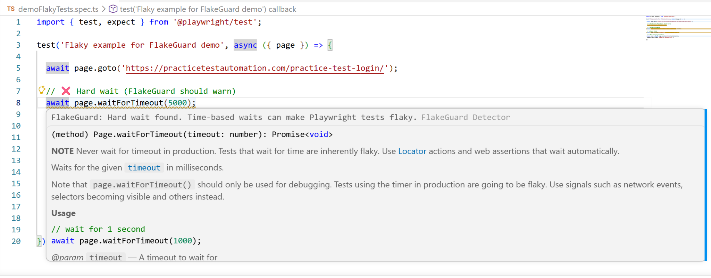
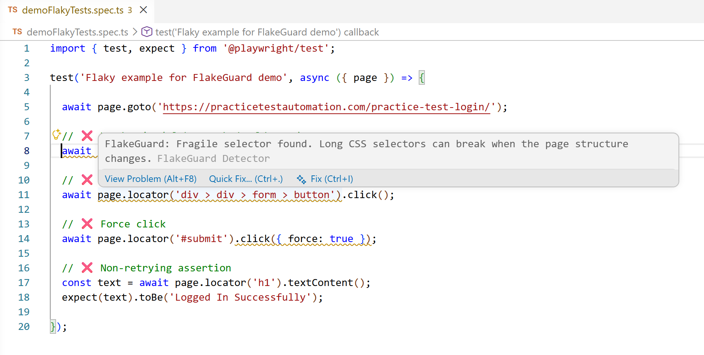

# FlakeGuard Detector

[Install from the VS Code Marketplace](https://marketplace.visualstudio.com/items?itemName=abhisheksahu-qa.flakeguard-detector) | [Source code](https://github.com/abhisheksahu-qa/flakeguard-detector) | MIT License

FlakeGuard Detector highlights common patterns that can make Playwright tests unreliable **while you write them in VS Code**. It explains the risk, suggests safer alternatives and provides Quick Fix actions for supported cases. It does not need to run the test to inspect the code.

## New in v0.0.4: Context-Aware SafeFix

Earlier Quick Fix suggestions could be generic. **Context-Aware SafeFix now looks for locator information already available in the test before suggesting a change.**

- Suggests locator-based waits when a suitable existing locator can be identified.
- Can recommend removing an unnecessary `waitForTimeout()` before a Playwright action that already auto-waits.
- Suggests auto-retrying Playwright assertions for supported non-retrying checks.
- Avoids inventing placeholder locators when the target element is unclear.
- Explains the risk so the engineer can review the change before accepting it.

### Example

Before:

```ts
const loginButton = page.getByRole('button', { name: 'Login' });

await page.waitForTimeout(5000);
await loginButton.click();
```

One supported SafeFix suggestion uses the existing `loginButton` locator:

```ts
const loginButton = page.getByRole('button', { name: 'Login' });

await loginButton.waitFor({ state: 'visible' });
await loginButton.click();
```

Depending on context, removing the hard wait may also be appropriate because Playwright's `click()` action already performs its own actionability checks. **Always review a suggested fix for your test.**

## Patterns FlakeGuard detects

- Hard waits, such as `page.waitForTimeout()`
- Long, structure-dependent CSS selectors
- `nth-child` selectors
- Force clicks (`force: true`)
- Non-retrying assertions

Warnings appear in the editor, with explanations and available Quick Fixes.

## How to use

1. Install FlakeGuard Detector from the Marketplace.
2. Open a Playwright JavaScript or TypeScript test in VS Code.
3. Read any inline warnings and hover over a finding for the explanation.
4. Use **Ctrl+.** (or **Cmd+.** on macOS) to review available Quick Fixes.
5. To get an overview, open the Command Palette and run **FlakeGuard: Show Flakiness Summary**.

## What FlakeGuard does not do

FlakeGuard is a preventive code-review aid, not a Playwright test runner. It cannot prove a test is flaky, guarantee a suggested edit will resolve failures, or verify that a locator identifies the intended element in a live application. It flags supported code patterns and helps engineers review them earlier.

## Examples from the editor





## Feedback and development

If you find an incorrect suggestion or have an improvement idea, please open a [GitHub issue](https://github.com/abhisheksahu-qa/flakeguard-detector/issues). See the [changelog](./CHANGELOG.md) for version-specific updates.

## License

MIT
